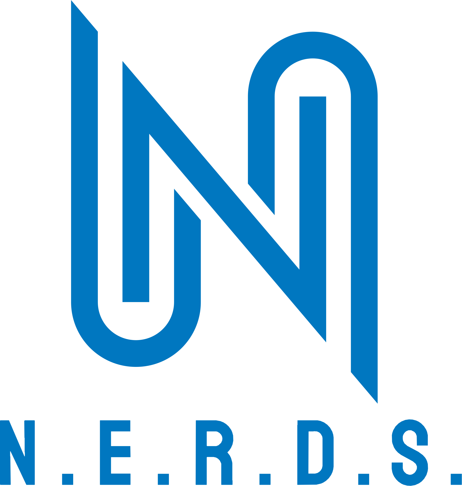
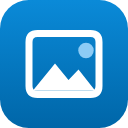
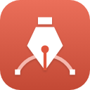
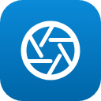
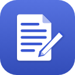
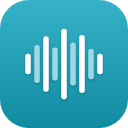
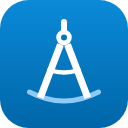
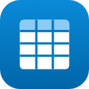

<p align="center">
  
</p>

<h1 align="center">NERDS Launcher</h1>

<p align="center">
  <b>One place to install, update and open every app in the NERDS Suite.</b><br>
  NERDS Photo, Vector, Film, Light, PDF, Effects, Layout, Proto, Word, Sound, Deck, CAD and Grid:<br>
  the right build for your computer, kept up to date.
</p>

<p align="center">
  <a href="https://github.com/nerds-coach/nerds-launcher/releases/latest"><b>Download NERDS Launcher</b></a> (Windows and Mac)
</p>

<p align="center">
  
  
  
  
  
  
  
  
  
  
  
  
  
</p>

NERDS Launcher is the NERDS edition of [ArtCraft Launcher](https://github.com/storytold/craft-launcher),
the open-source launcher for ArtCraft's free creative apps. It lists every app, shows which ones
you have and which version, installs the right build for your operating system and processor,
and tells you when an update is out. It is a small native Rust app that can sit in your menu bar
or system tray.

What changed for NERDS (names, colours, logo, icons, and what is switched off until NERDS has its
own builds) is listed in [NERDS.md](NERDS.md).

## The apps

| | NERDS name | What it's for | Built from |
|:-:|---|---|---|
|  | **NERDS Photo** | Image editing: layers, masks, type and real PSD files | [PhotoCraft](https://github.com/storytold/photocraft) |
|  | **NERDS Vector** | Vector illustration | [VectorCraft](https://github.com/storytold/vectorcraft) |
|  | **NERDS Film** | Video editing, color and sound | [FilmCraft](https://github.com/storytold/filmcraft) |
|  | **NERDS Light** | Photo library and raw development | [LightCraft](https://github.com/storytold/lightcraft) |
|  | **NERDS PDF** | Reading, organizing and protecting PDFs | [PdfCraft](https://github.com/storytold/pdfcraft) |
|  | **NERDS Effects** | Motion graphics and visual effects | [EffectCraft](https://github.com/storytold/effectcraft) |
|  | **NERDS Layout** | Page layout and publishing | [DesignCraft](https://github.com/storytold/designcraft) |
|  | **NERDS Proto** | Interface design and prototyping | [FigCraft](https://github.com/storytold/figcraft) |
|  | **NERDS Word** | Writing and document design | [WordCraft](https://github.com/storytold/wordcraft) |
|  | **NERDS Sound** | Recording, editing and mixing audio | [SoundCraft](https://github.com/storytold/soundcraft) |
|  | **NERDS Deck** | Presentations and slide shows | [DeckCraft](https://github.com/storytold/deckcraft) |
|  | **NERDS CAD** | Computer-aided design and drafting | [CADCraft](https://github.com/storytold/cadcraft) |
|  | **NERDS Grid** | Spreadsheets and data | [GridCraft](https://github.com/storytold/gridcraft) |

## Where apps are installed

Each app goes where your system normally keeps applications, from the app's official release
package: `/Applications` on macOS, `%LOCALAPPDATA%\Programs` or `C:\Program Files` on Windows (through
Windows Installer), and the system's package manager, a Flatpak or an AppImage on Linux. Every
download is checked against the release's published SHA-256 before it is installed, and a running
app is never replaced.

## Interface languages

English, Brazilian Portuguese, Czech, French, German, Hungarian, Japanese, Polish, Russian,
Simplified Chinese and Spanish. **Auto** follows the system language; **Settings → Language**
picks one. App names stay in English.

## Build from source

You need a recent stable Rust (1.90 or newer). On Linux, install the windowing headers first
(Debian/Ubuntu: `sudo apt install libxkbcommon-dev libwayland-dev libx11-dev libxrandr-dev libxi-dev libgl1-mesa-dev`).

```sh
cargo run --release -p artcraft-launcher   # the desktop app
cargo xtask ci                             # fmt, clippy, tests and the wasm check
```

The web version builds with [trunk](https://trunk-rs.github.io/trunk/):

```sh
rustup target add wasm32-unknown-unknown
cd apps/artcraft-launcher-web && trunk serve
```

Release packaging lives in [`packaging/`](packaging/) and
[`.github/workflows/release.yml`](.github/workflows/release.yml). Contributors and AI agents: read
[`NERDS.md`](NERDS.md), then [`AGENTS.md`](AGENTS.md).

## License and credits

NERDS Launcher is built on [ArtCraft Launcher](https://github.com/storytold/craft-launcher) by the
ArtCraft Team and the ArtCraft Launcher contributors, and installs ArtCraft's open-source apps. Its
code is dual-licensed under [MIT](LICENSE-MIT) or [Apache-2.0](LICENSE-APACHE), at your option;
required notices are in [NOTICE](NOTICE).

The NERDS name, N mark, N.E.R.D.S. lettering and the NERDS app icons are NERDS brand assets, not
covered by the code license: [`docs/brand/LICENSE-brand.txt`](docs/brand/LICENSE-brand.txt).
Bundled fonts and other assets keep their own open licenses, listed in
[ATTRIBUTION.md](ATTRIBUTION.md).
